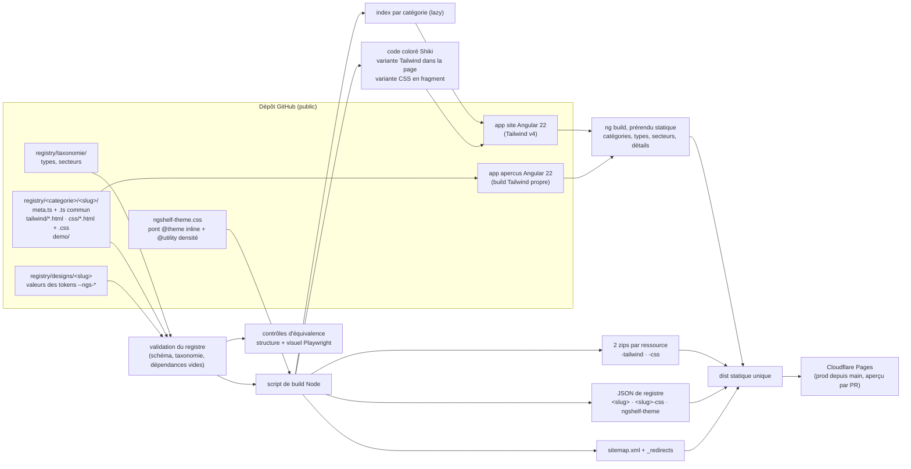
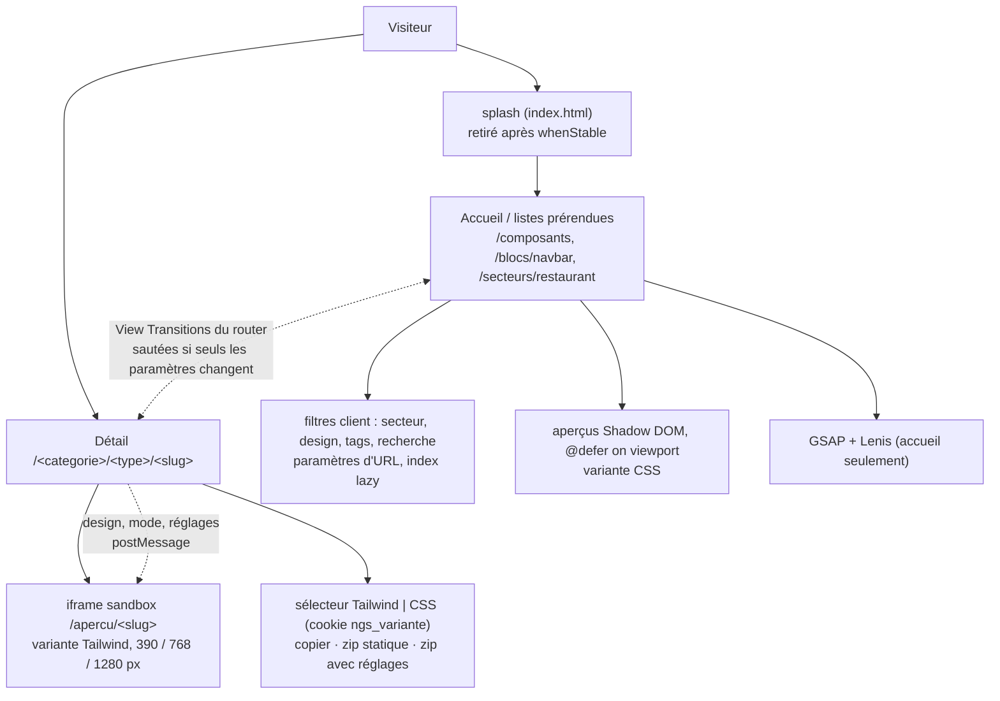

# Architecture prévue du catalogue

Prévu, non construit. Décisions : ADR 0001 à 0013, tous `accepté` au 2026-11-27 (décisions de Sidy).

## Comment une ressource devient des pages, des aperçus et des fichiers

Répond à : d'où vient chaque chose affichée ou téléchargée, et où les deux variantes se séparent.

## Ce que le navigateur charge

Répond à : quelles pièces tournent chez le visiteur, quelle variante est rendue où, et isolée comment.

