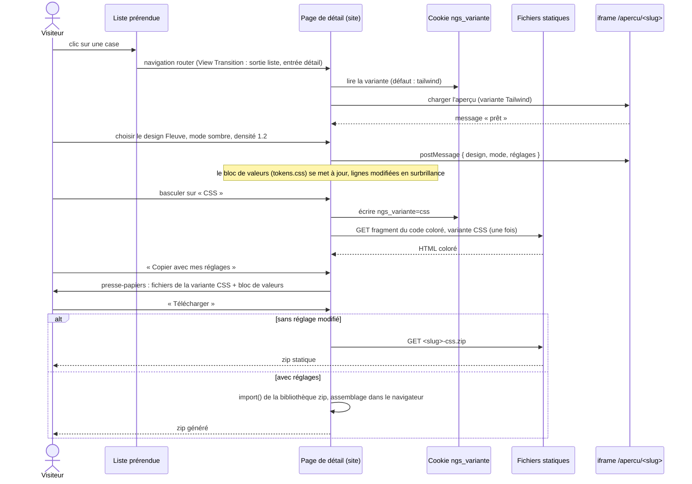

# Flux prévu — page de détail : choisir une variante, régler, copier, télécharger

Prévu, non construit. Décisions : ADR 0002 (variantes, distribution), 0003 (aperçus), 0005 (transitions).

## Cas nominal

## Cas d'erreur principaux

- **Presse-papiers refusé** (permission, contexte non sécurisé) : message « Copie impossible, sélectionnez le code » et sélection automatique du bloc de code ; aucune erreur silencieuse.
- **Fragment de code ou zip injoignable** (hors ligne, 404 après déploiement) : état `hors-ligne` ou `erreur` de `angular-sidy` §4 sur la zone de code, bouton « Réessayer » ; le sélecteur revient à la variante affichée.
- **Aperçu qui ne répond pas** (pas de message « prêt » après un délai fixé en constante) : la zone d'aperçu affiche l'état `erreur` avec « Recharger l'aperçu » ; le code reste copiable.
- **Message d'une autre source** : ignoré. Côté site, `event.source` doit être la fenêtre de l'iframe (l'origine d'une iframe sandbox sans `allow-same-origin` vaut `null`, elle ne peut pas servir de contrôle) ; côté aperçu, l'origine du site est vérifiée.
- **Cookie absent ou valeur inconnue** : variante Tailwind.
